# ICODE2026

Conference website for the **International Conference on Open and Digital Education (ICODE2026)**, hosted by the Centre for Open and Distance Learning (CODL), University of Moratuwa, Sri Lanka.

The site introduces the hybrid conference (5–7 August 2026, Colombo), publishes the call for papers, and points authors to submission templates and the Microsoft CMT portal. Registration and the detailed programme are present as pages and are marked as coming soon.

This is a static front end. There is no application server, database, or environment-variable configuration.

## Contents

- [Key features](#key-features)
- [Screenshots](#screenshots)
- [Technologies](#technologies)
- [Installation and setup](#installation-and-setup)
- [Project structure](#project-structure)
- [Working with the project](#working-with-the-project)

## Key features

### Home page

The home page (`/`) is the public overview of the conference.

- A sticky header carries the University of Moratuwa and CODL marks, in-page links (About, Important Dates, Committees, Contact), a link to Registration, and a **Submit Abstract** button. On narrow screens the same links open from a menu button.
- The hero states the conference name, host, dates (5–7 August 2026), and hybrid venue, and links to abstract submission, registration, and the programme page.
- **About ICODE2026** explains the three-day arc from policy, to research, to practice, and includes a campus photograph.
- **A Three-day Integrated Programme** summarises Day 1 (Policy & Leadership Summit, 5 August), Day 2 (Academic Research Conference, 6 August), and Day 3 (Practice & Innovation Workshops, 7 August).
- **Important Dates** reads from `src/constants/importantDates.ts` and renders as a horizontal timeline on desktop and a vertical timeline on small screens. Each date has an **Add to calendar** control that opens a prefilled Google Calendar event for that milestone.
- **Why participate?** lists who the conference is for and what attendees can take away.
- **Partners & Sponsors** is a looping strip of the University of Moratuwa, CODL, and CODL 20th-anniversary marks.
- **Conference Governance and Organisation** introduces three groups — Strategic Leadership, Academic & Publications, and Operations & Experience — and links each card to the matching section on `/governance`.
- **Frequently Asked Questions** is an accordion. The first question is open on load. Topics cover audience, format, submissions, registration, venue, and language.
- A host-institution panel describes CODL, the Bachelor of Information Technology (External) programme ([bit.uom.lk](https://bit.uom.lk/)), and the University of Moratuwa ([uom.lk](https://uom.lk/)).
- **Get in Touch** lists `icode@codl.lk`, the office phone, the Katubedda postal address, an embedded map of the University of Moratuwa, and links to Facebook, Instagram, YouTube, and bit.uom.lk.
- The footer repeats conference links, contact details, and social links.

### Call for papers

`/call-for-papers` is the author-facing page.

- **Key Submission Dates** reuses the shared dates list. The final milestone is shown as 6 August 2026 on this page (the research conference day). The home page keeps the full 5–7 August range.
- **Submit Abstract** opens the Microsoft CMT conference site: [cmt3.research.microsoft.com/ICODE2026](https://cmt3.research.microsoft.com/ICODE2026).
- **Extended Abstract – Quick Overview** states the expected length (2–3 pages, 700–1,000 words) and the points a submission should cover.
- **Conference Themes** lists eight themes, including digital transformation, artificial intelligence in education, online pedagogy, open and distance learning, micro-credentials, ethics and quality assurance, and access and equity.
- **Extended Abstract Template – Section Overview** walks through the eight template sections, from introduction through APA 7th-edition references.
- **Author Guidelines** covers language, word and page limits, downloads for the Word template and the LaTeX template (`.zip`), CMT account and PDF-only submission rules, the double-blind review policy, author responsibilities, ethics, and the generative-AI policy.
- A short acknowledgement that Microsoft CMT was used for peer review is shown on this page only (see `index.html`).

### Governance

`/governance` lists the people behind the conference, with photographs from `src/assets/committee/` and a fallback portrait when a photo is not matched.

The page is split into three anchored sections:

| Section | Anchor | Committees |
| --- | --- | --- |
| Main organising committee | `#strategic` | Event Patron, Event Co-chairs |
| Academic & publications | `#academic` | Publications & Proceedings |
| Operations & experience | `#operations` | Media, Communications & Branding; Policy & Leadership Summit; Finance & Sponsorship; Logistics & Operations; Ethics; Student Coordination |

### Registration and programme

- `/registration` explains that registration is not open yet and lists the details that will appear later: fee categories, payment and invoices, early-bird and group options, and the registration form.
- `/programme` explains that the day-by-day schedule is not published yet. The page reserves space for keynotes, parallel and workshop sessions, policy dialogues, and a downloadable PDF schedule.

### Shared behaviour

- A floating WhatsApp button is mounted on every route. It periodically shows a short “Need help? Chat with us.” hint and links to the chat URL in `src/constants/contact.ts`. The footer and the call-for-papers secretariat block open WhatsApp for the published office number.
- In-page links account for the sticky header. Route changes scroll to the top.
- Sections fade or rise into view as they enter the viewport. When the visitor prefers reduced motion, those animations are skipped.

## Screenshots

Captured from the local development server. Desktop frames are 1440×900. The navigation frame is a 390×844 phone layout.

### Home

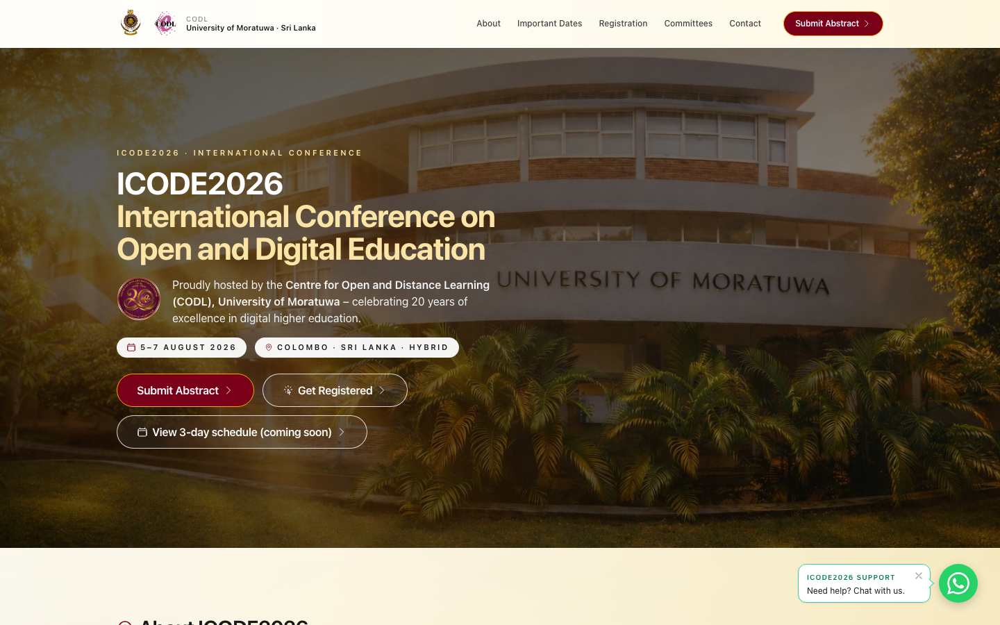

The home hero, with the conference title, CODL’s 20th-anniversary mark, the 5–7 August 2026 dates, the hybrid Colombo venue, and links to submit an abstract, register, or open the programme page.

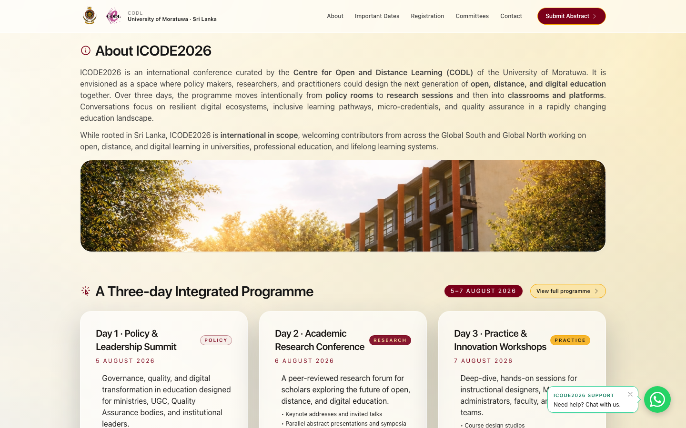

The About section, including the campus photograph, followed by the opening of the three-day programme.

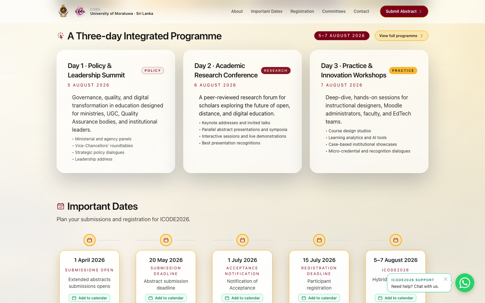

The three programme days in full: Policy & Leadership Summit, Academic Research Conference, and Practice & Innovation Workshops.

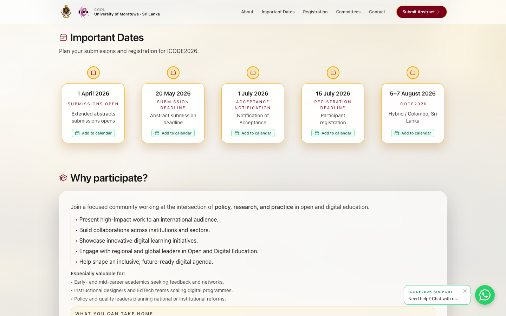

The desktop important-dates timeline, from submissions opening on 1 April 2026 through the conference on 5–7 August 2026. Each card can add that date to Google Calendar.

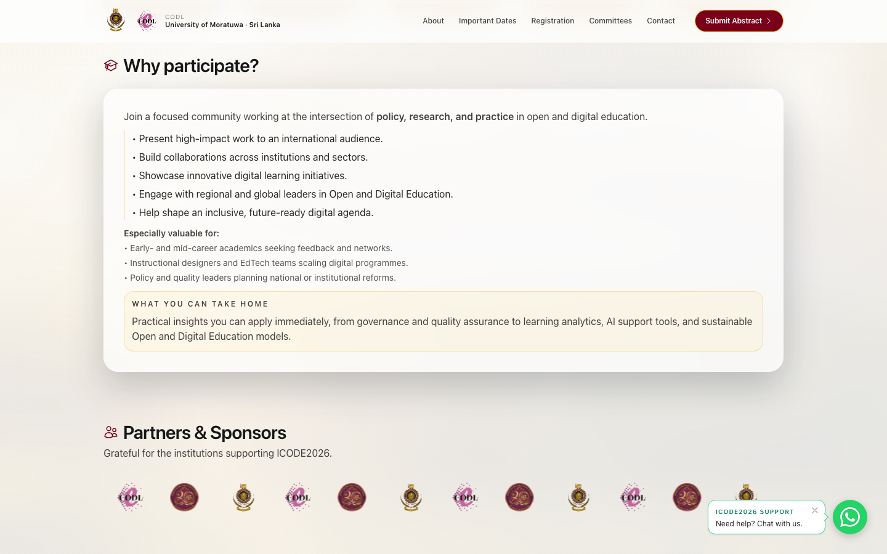

Reasons to attend, and the partners strip of University of Moratuwa, CODL, and 20th-anniversary marks.

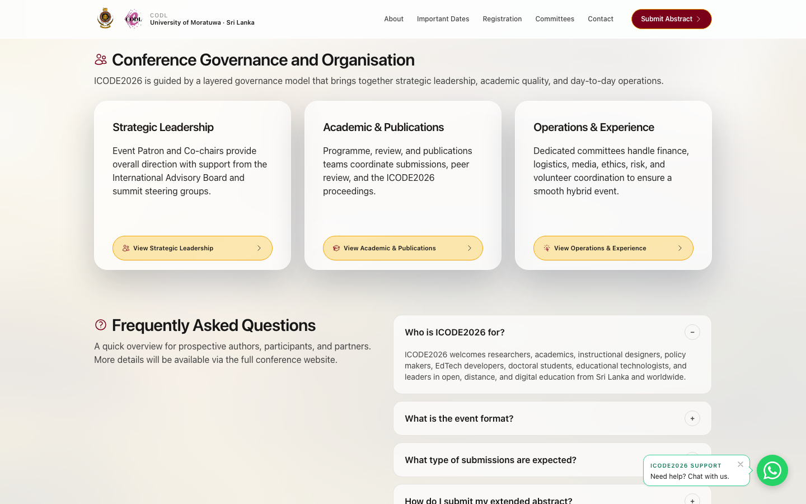

The three governance summaries on the home page. Each card links to the matching block on the governance page. The FAQ accordion below opens one answer at a time.

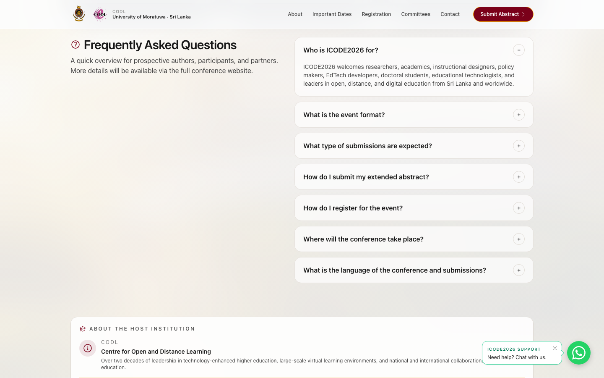

The FAQ list. The first item, “Who is ICODE2026 for?”, is expanded by default. The host-institution panel begins underneath.

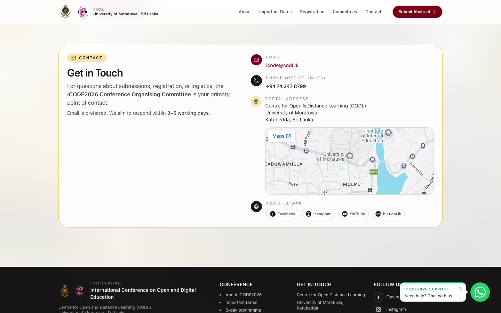

Contact details for the organising committee: email, phone, postal address, the University of Moratuwa map, and social links.

### Call for papers

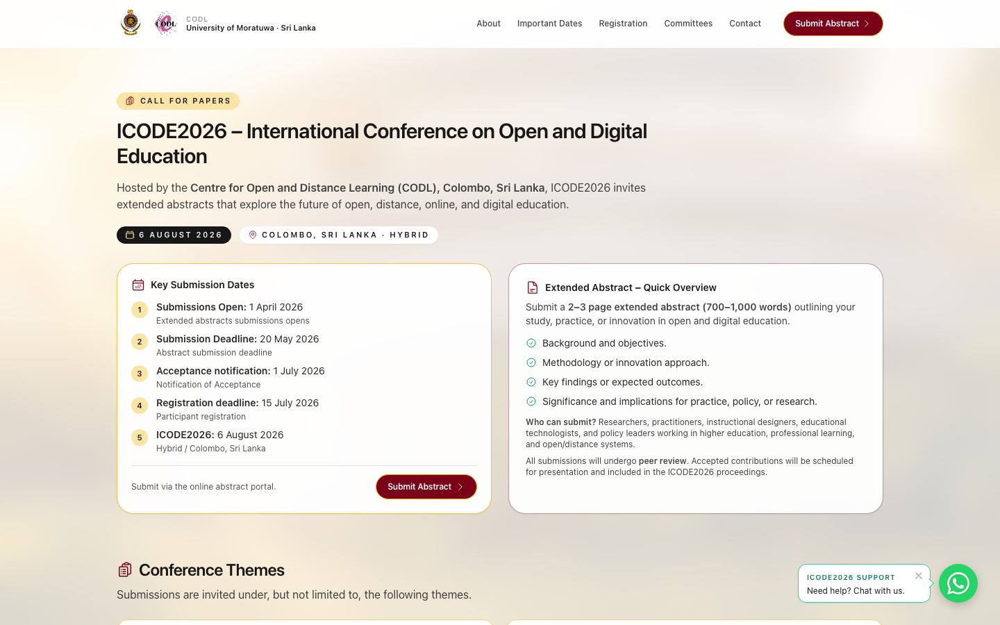

The call-for-papers introduction, the numbered submission timeline, and the extended-abstract overview. **Submit Abstract** leaves the site for CMT.

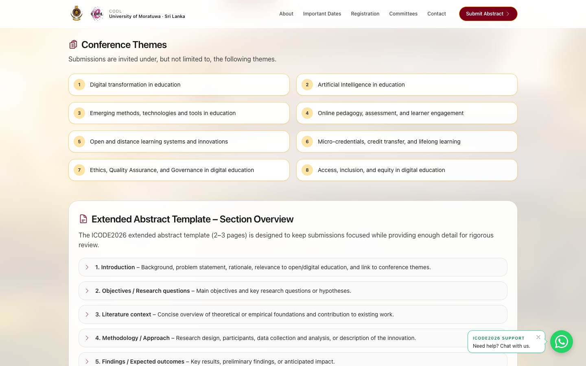

The eight conference themes, then the start of the extended-abstract section overview.

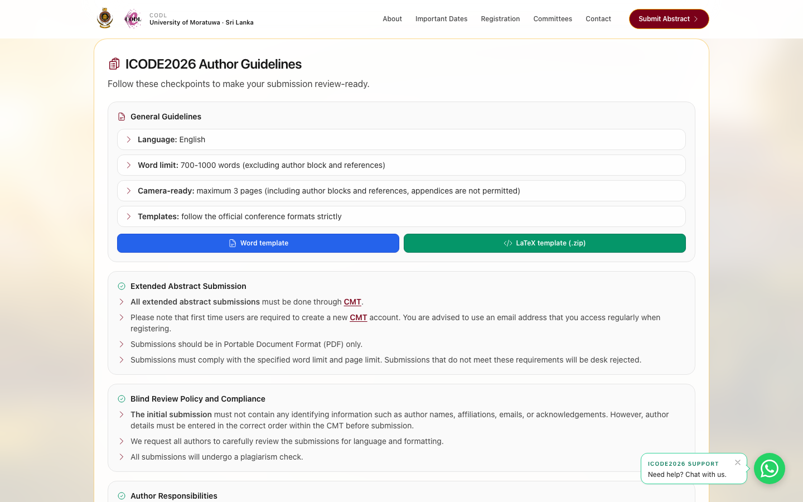

Author guidelines, including the Word and LaTeX template downloads, CMT submission rules, and the blind-review policy.

### Governance, registration, and programme

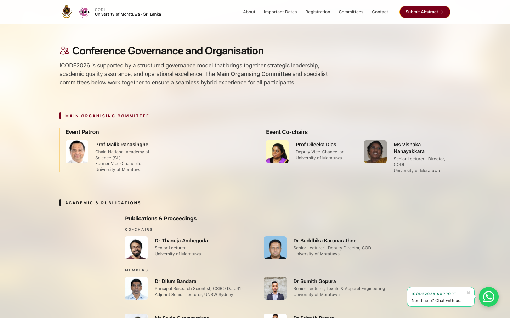

The governance page, starting with the Event Patron and Event Co-chairs, then Publications & Proceedings.

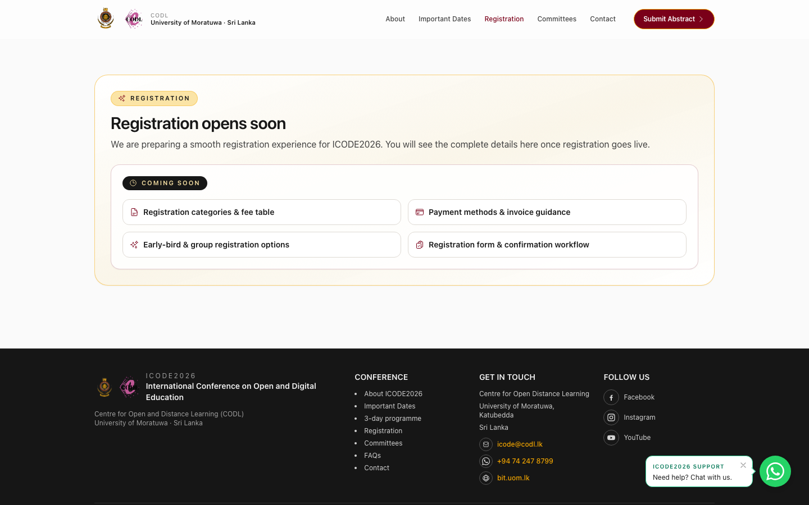

The registration page in its current state: registration is not open, and the page lists what will be published when it is.

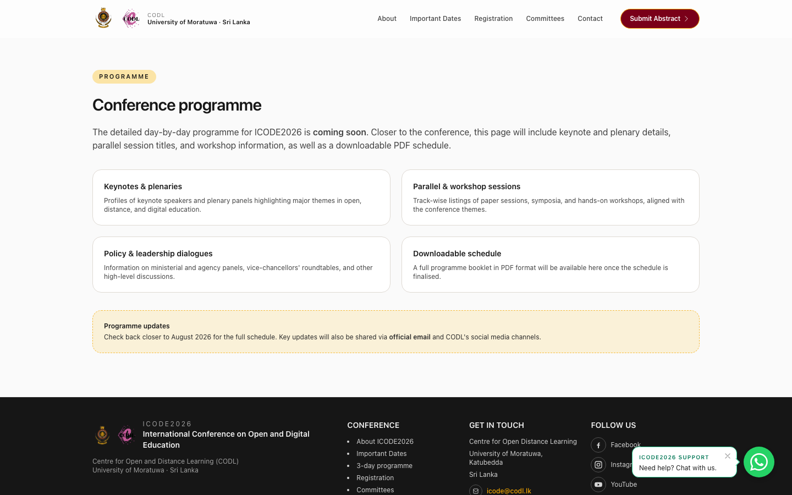

The programme page, with placeholders for keynotes, sessions, policy dialogues, and a PDF schedule.

### Small screens

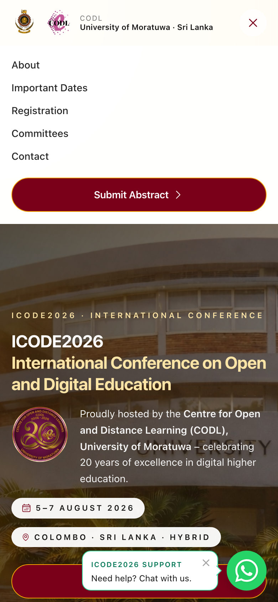

The home page on a phone-width layout, with the navigation menu open. The same pages are reachable from this menu, and the WhatsApp hint sits above the chat button.

## Technologies

| Area | What the project uses |
| --- | --- |
| Language | TypeScript |
| UI | React 18 |
| Routing | React Router 7 (`BrowserRouter`) |
| Build | Vite 6 with `@vitejs/plugin-react-swc` |
| Styling | Tailwind CSS 3, PostCSS, Autoprefixer |
| Icons | `@heroicons/react` (outline set) |
| UI pieces | Local `Button`, `Card`, `Badge`, and `Accordion` components in `src/components/ui` |
| Templates | Word (`.docx`) bundled from `src/assets/docs`; LaTeX zip served from `public/docs` |

Styling is Tailwind utility classes. Buttons, cards, badges, and the accordion are the local components under `src/components/ui`.

Brand colours are defined in `tailwind.config.cjs`: maroon `#7A0019` and gold `#F6A800`, with a softer gold `#FBE4A6`.

## Installation and setup

Requirements:

- Node.js 18, 20, or 22 or newer (the range accepted by the installed Vite 6 release)
- npm

Clone the repository and install dependencies:

```bash
git clone https://github.com/KaveeSL/ICODE-2026.git
cd ICODE-2026
npm install
```

Start the development server:

```bash
npm run dev
```

Vite prints a local URL, typically `http://127.0.0.1:5173/`. Dates, contact details, and the Vite `base` path are set in source files. The app does not read environment variables.

Production build and local preview:

```bash
npm run build
npm run preview
```

`npm run build` writes a static site to `dist/`. `vite.config.ts` sets `base` to `"./"`, so the built files can be hosted from a subfolder as well as from a domain root. Copy `dist/` to any static host. Client-side routes (`/call-for-papers`, `/governance`, `/registration`, `/programme`) need the host to serve `index.html` for those paths.

## Project structure

```text
ICODE-2026/
├── index.html                 # Document shell, favicon, CMT acknowledgement
├── package.json
├── vite.config.ts             # React plugin and relative base path
├── tailwind.config.cjs        # Brand colours and content paths
├── postcss.config.cjs
├── tsconfig.json
├── public/
│   └── docs/                  # Files copied as-is into the build (LaTeX zip)
├── docs/
│   └── screenshots/           # Images used in this README
└── src/
    ├── main.tsx               # Router and WhatsApp button
    ├── App.tsx                # Home page
    ├── CallForPapersPage.tsx
    ├── GovernancePage.tsx
    ├── RegistrationPage.tsx
    ├── ProgrammePage.tsx
    ├── Footer.tsx
    ├── index.css              # Tailwind layers, motion, sponsor strip, WhatsApp styles
    ├── constants/
    │   ├── importantDates.ts  # Shared milestone dates
    │   └── contact.ts         # Phone, email helpers, WhatsApp URLs
    ├── components/
    │   ├── Reveal.tsx         # Scroll-in animation
    │   ├── WhatsAppFloat.tsx
    │   ├── ContactWhatsAppFooterItem.tsx
    │   ├── ContactBitWebsiteFooterItem.tsx
    │   └── ui/                # Button, Card, Badge, Accordion
    └── assets/
        ├── logo.png, codllogo.png, 20thAnniversarylogo.png
        ├── bgmain.png, bgimg.PNG
        ├── committee/         # Portrait photos used on the governance page
        └── docs/              # Word template imported by the call-for-papers page
```

Routes registered in `src/main.tsx`:

| Path | Page |
| --- | --- |
| `/` | Home (`App.tsx`) |
| `/call-for-papers` | Call for papers |
| `/governance` | Committees and office holders |
| `/registration` | Registration (coming soon) |
| `/programme` | Programme (coming soon) |

## Working with the project

**Dates.** Change milestones in `src/constants/importantDates.ts`. The home timeline and the call-for-papers date list both read that array. The call-for-papers page replaces only the last date with 6 August 2026.

**Contact details.** Phone display text, the `tel:` link, and both WhatsApp URLs live in `src/constants/contact.ts`. The public email `icode@codl.lk` is written in the home page, footer, and call-for-papers page.

**Committees.** Names, roles, and designations are the `committeeGroups` data at the top of `src/GovernancePage.tsx`. Portraits are matched from `src/assets/committee/`.

**Author templates.** The Word file downloaded from the guidelines is `src/assets/docs/ICODE2026-Extended Abstract Template.docx`. The LaTeX download is `public/docs/ICODE26_template_latex.zip`, requested with Vite’s `BASE_URL` so the relative build base still resolves.

**Submission portal.** Abstract submission is an external link to Microsoft CMT. Authors upload PDFs on that portal.

**Motion.** `Reveal` uses `IntersectionObserver`. It renders content immediately when `prefers-reduced-motion: reduce` is set. The sponsor strip and WhatsApp button animations in `src/index.css` follow the same preference.

**Scripts.**

| Command | Purpose |
| --- | --- |
| `npm run dev` | Vite development server with hot reload |
| `npm run build` | Production bundle written to `dist/` |
| `npm run preview` | Serve the production bundle locally |
